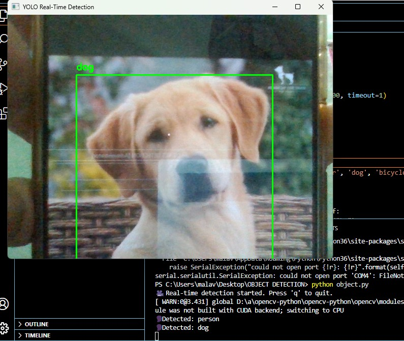
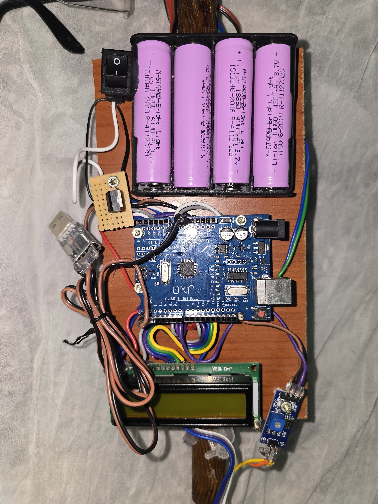
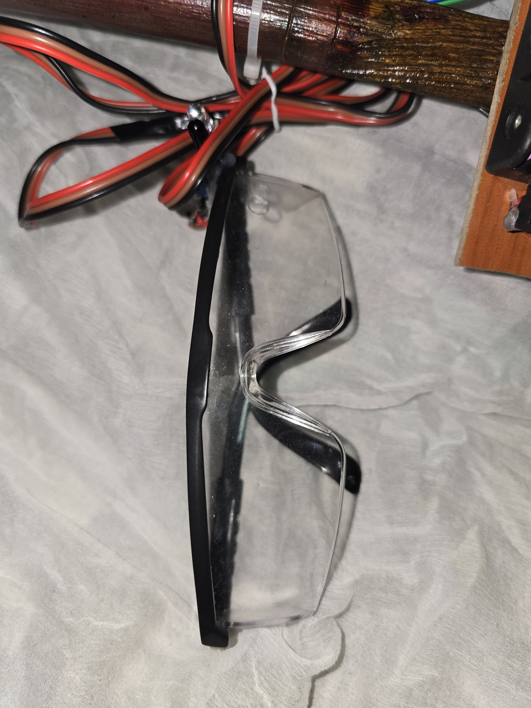
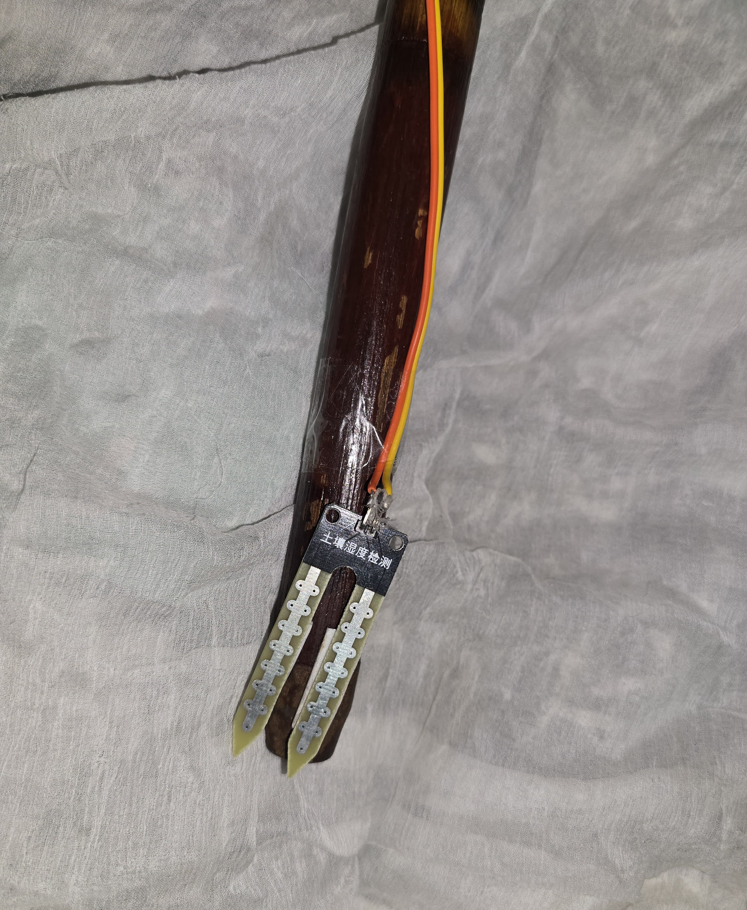

# A Smart Kit Approach for Visually Impaired People

An assistive smart kit that helps visually impaired people move around more safely and independently. It combines a camera with real-time object detection, ultrasonic sensors, haptic (vibration) feedback and voice alerts, so the user knows what is in front of them without relying only on a white cane.

> B.Tech final-year project, Artificial Intelligence and Data Science
> Dhanalakshmi Srinivasan Engineering College (Autonomous), Perambalur (Anna University), May 2025



---

## Problem

More than 2.2 billion people worldwide live with some form of visual impairment (WHO). Traditional aids like white canes and guide dogs can't detect overhead or moving obstacles, and they don't give a full picture of what's around the user. Many electronic travel aids are expensive, uncomfortable or hard to learn, so few people use them.

## Solution

The kit (named **Path Saarathi** in the report) is built around three modules:

| Module | What it does | Hardware |
|---|---|---|
| **Path Detection (PD)** | Detects obstacles and safe paths using a camera and a machine learning model, and announces them through an earphone | Web camera, processor, earphone |
| **Depth Perception (DEP)** | Measures distance to obstacles at different heights and warns the user with vibrations that get stronger as obstacles get closer, plus a buzzer | 5 ultrasonic sensors, 4 micro-vibration motors, buzzer, microcontroller |
| **Navigation (NAV)** | Tracks location and gives turn-by-turn spoken directions | GPS receiver, Google Maps API, keypad |

### Features
- Real-time object detection with **YOLOv3** (person, chair, car, dog, bicycle)
- **Voice feedback**: detected objects are spoken aloud with text-to-speech
- **Haptic and buzzer alerts** driven by an Arduino over a serial connection
- Hands-free and wearable, for indoor and outdoor use

## How it works

```
Webcam ──► YOLOv3 (OpenCV DNN) ──► detected objects
                                     │
                     ┌───────────────┴───────────────┐
                     ▼                               ▼
          Text-to-speech (pyttsx3)        Serial command to Arduino
          "Detected: person, car"         (A/B/c/D/E per object)
                                                     │
                                                     ▼
                                       Vibration motors / buzzer
```

Serial codes sent to the microcontroller:

| Object | Code |
|---|---|
| person | `A` |
| chair | `B` |
| car | `c` |
| dog | `D` |
| bicycle | `E` |

## Tech stack

- **Language:** Python
- **Computer vision:** OpenCV (DNN module), YOLOv3 trained on COCO
- **Speech:** pyttsx3 (offline text-to-speech)
- **Hardware link:** pySerial → Arduino Uno
- **Hardware:** ultrasonic sensors, vibration motors, buzzer, GPS module, web camera, Li-ion battery pack

## Prototype

| Controller unit | Wearable glasses with sensor | Moisture sensor on stick |
|---|---|---|
|  |  |  |

The controller unit is an Arduino Uno with a 16x2 LCD, a power switch and four 3.7 V 18650 Li-ion cells, mounted on a board.

## Getting started

### 1. Install dependencies
```bash
pip install -r requirements.txt
```

### 2. Download the YOLOv3 model files
Put these three files in the same folder you run the script from:
- `yolov3.cfg`: https://github.com/pjreddie/darknet/blob/master/cfg/yolov3.cfg
- `yolov3.weights`: https://pjreddie.com/media/files/yolov3.weights (about 240 MB)
- `coco.names`: https://github.com/pjreddie/darknet/blob/master/data/coco.names

### 3. Connect the hardware
Connect the Arduino over USB and set the right port in `src/object_detection.py`:
```python
ser = serial.Serial('COM4', baudrate=9600, timeout=1)
```

### 4. Run
```bash
python src/object_detection.py
```
Press **q** to quit.

> The code asks OpenCV to use CUDA. If your OpenCV build doesn't have CUDA, it falls back to the CPU automatically and still works.

## Results

A usability study was run with **10 visually impaired participants** in indoor and outdoor settings:
- **80%** found the kit helpful for mobility and navigation
- **60%** said it reduced the mental effort of navigating
- Users had fewer collisions than with a white cane alone

## Future work
- Deep learning models for more accurate obstacle and path detection
- LiDAR for better depth perception in crowded places
- Smaller, lighter hardware
- Better GPS accuracy using cloud processing
- Voice-assistant integration (Google Assistant / Alexa)
- Testing with a larger group of users

## Documentation
- [Research paper](docs/Research_Paper.docx)

## Team
- Akshaya Santhosh
- Lima C J
- Malavika M A

**Guide:** Mr. Saravanan S, Assistant Professor, Department of AI and Data Science

## Acknowledgements
This project builds on the approach described in:
> Bhatlawande, S., Borse, R., Solanke, A., & Shilaskar, S. (2024). *A Smart Kit Approach for Augmenting Mobility of Visually Impaired People.* IEEE Access, 12, 24659–24671. DOI: [10.1109/ACCESS.2024.3364915](https://doi.org/10.1109/ACCESS.2024.3364915)

Object detection uses [YOLOv3](https://pjreddie.com/darknet/yolo/) by Joseph Redmon and Ali Farhadi.
